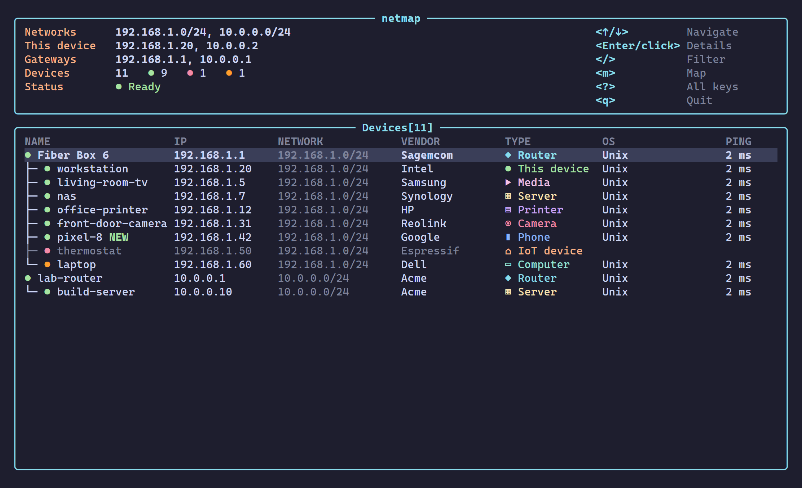
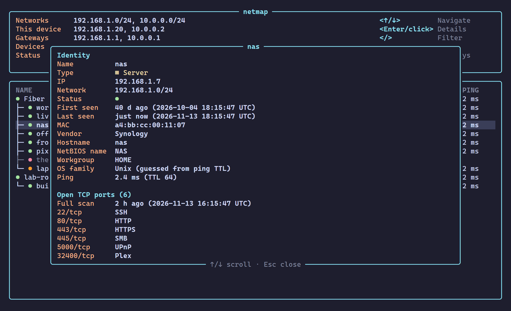
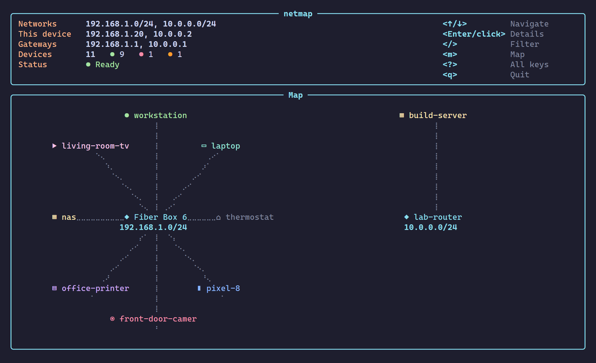
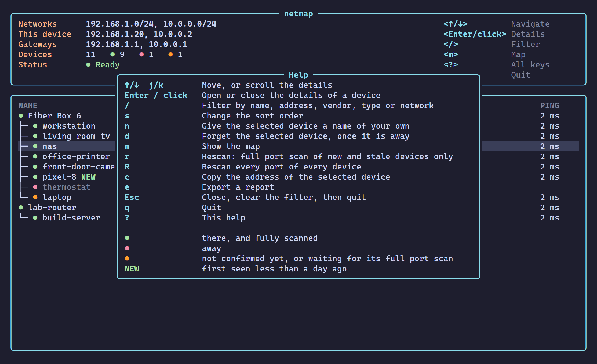

# netmap

**See everything that is connected to your network, from your terminal.**

`netmap` scans the networks your machine is on, works out what each device is
(router, computer, phone, printer, camera, TV, server, IoT device) and shows it in a
keyboard-driven interface inspired by k9s.



## Why

Most people cannot answer a simple question: *what is on my Wi-Fi right now?*
The router's admin page gives a list of cryptic names, and the classic tools give raw
text that you have to read line by line and cross-check yourself.

`netmap` answers that question in one command:

- **Know what is on your network.** Every device gets a name, a type, a vendor, an
  operating system family and its open ports.
- **Spot what should not be there.** A device seen for the first time is flagged `NEW`;
  a device that left turns red. An unknown phone or an unexpected open port stands out.
- **Find a device quickly.** Looking for the address of the printer, the NAS or a
  Raspberry Pi? Filter by name, copy the IP, done.
- **Keep a record.** Results are remembered between runs, and a Markdown report can be
  exported for an audit or a hand-over.
- **Nothing to set up.** One binary, no administrator rights, no packet-capture driver,
  no account, nothing sent to the internet.

It is meant for your own network, or one you are allowed to scan.

## What it shows

| | |
|---|---|
|  |  |
| **Details**: press `Enter` or click a device | **Map**: press `m` |

For each device:

- name, IP address, network, MAC address and vendor
- type and operating system family
- presence: green (there), red (away), orange (being checked)
- response time, first and last time it was seen
- every open TCP port (1 to 65535) with the service usually found behind it
- what the device says about itself: UPnP model and maker, mDNS services, NetBIOS name
  and workgroup

## How it finds devices

It only uses what any ordinary program is allowed to do, so it needs no special rights:

- TCP connections to common ports, then the system's ARP table
- `ping`, to measure the response time and guess the OS family
- SSDP/UPnP, mDNS and NetBIOS, to ask devices who they are
- reverse DNS, for host names
- a full TCP port scan of each device, redone only for new devices or after 24 hours

Every network the machine is connected to is scanned, each with its real mask.

## Install

You need [Rust](https://rustup.rs).

```sh
git clone https://github.com/Neotoxic-off/netmap.git
cd netmap
cargo build --release
```

The binary is `target/release/netmap` (`netmap.exe` on Windows). Run it, with no argument.

## Keys

| Key | Action |
|---|---|
| `↑` `↓` / `j` `k` | Move, or scroll the details |
| `Enter` / click | Open or close the details of a device |
| `/` | Filter by name, address, vendor, type or network |
| `s` | Change the sort order |
| `n` | Give the selected device a name of your own |
| `c` | Copy the address of the selected device |
| `d` | Forget the selected device, once it is away |
| `m` | Show the map |
| `r` | Rescan (full port scan of new and stale devices only) |
| `R` | Rescan every port of every device |
| `e` | Export a Markdown report in the current folder |
| `?` | Help |
| `Esc` / `q` | Close, clear the filter, quit |



## Good to know

- Results are kept in `%LOCALAPPDATA%\netmap\devices.json` on Windows and
  `~/.cache/netmap/devices.json` elsewhere. That file and the exported reports hold MAC
  addresses, names and open ports in clear text: treat them as private.
- The map links each device to its gateway. It does not show which devices talk to each
  other directly: that cannot be observed without intercepting their traffic.
- Networks wider than a /20 are scanned only around this machine's address.
- Developed and tested on Windows. Linux and macOS build from the same code but have not
  been tried yet. Copying an address uses `clip`, `pbcopy` or `xclip`.
- The screenshots show a made-up network. Refresh them with
  `cargo test screenshots -- --ignored`, which writes one web page per screen in
  `target/screens`.

## Tests

```sh
cargo test
```

One test runs a real scan of the smallest local network, so the suite takes about half
a minute.
